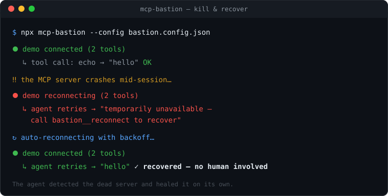

<div align="center">

# 🛡️ mcp-bastion

**A reliability &amp; security proxy for the Model Context Protocol (MCP).**

_Self-healing connections, runtime tool-security, and a compliance-mapped audit trail for your MCP servers._

[](https://www.npmjs.com/package/mcp-bastion)
[](https://www.npmjs.com/package/mcp-bastion)
[](https://registry.modelcontextprotocol.io/v0.1/servers?search=io.github.Gowthaman90/mcp-bastion)
[-2ea44f>)](https://github.com/Gowthaman90/mcp-defense-bench)
[](https://glama.ai/mcp/servers/Gowthaman90/mcp-bastion)
[](https://github.com/Gowthaman90/mcp-bastion/actions/workflows/ci.yml)
[](./LICENSE)
[](https://nodejs.org)
[](https://www.typescriptlang.org/)
[](#contributing)

<br/>



</div>

---

`mcp-bastion` sits between your MCP client (Claude Code, Cursor, Cline, Windsurf, Zed, Claude
Desktop, or any MCP-compliant agent) and your MCP servers. It is **client-agnostic** — it works with
any compliant client through configuration alone, with zero client-specific code — and **non-invasive**:
your servers run unchanged, and removing Bastion is a one-line config revert.

📦 **Package:** [`mcp-bastion` on npm](https://www.npmjs.com/package/mcp-bastion) · 🗂️ **Official MCP Registry:** `io.github.Gowthaman90/mcp-bastion`

🔒 **Security, measured:** on the open, vendor-neutral [mcp-defense-bench](https://github.com/Gowthaman90/mcp-defense-bench) v0.9.0, Bastion covers **66% of the MCP attack surface (24.6/37 vectors; 23 enforced)** on development fixtures and **53%** on the pre-registered held-out set, at zero false positives on matched controls — the broadest of the proxies measured.

📖 **Launch story:** [Medium](https://medium.com/p/e74f638e9e15) · [dev.to](https://dev.to/gowthaman90/the-mcp-reliability-security-gap-and-an-open-source-proxy-that-fills-it-3ppo)

👤 **Created & maintained by [Gowthaman Arumugam](https://github.com/Gowthaman90)** — Independent Researcher. Companion benchmark: [mcp-defense-bench](https://github.com/Gowthaman90/mcp-defense-bench).

## Contents

- [Why](#why)
- [How it works](#how-it-works)
- [Features](#features)
- [Quick start](#quick-start)
- [Demo](#demo)
- [Control tools](#control-tools)
- [Configuration](#configuration)
- [Transports](#transports)
- [Per-user identity (gateway mode)](#per-user-identity-gateway-mode)
- [Delegation checks](#delegation-checks)
- [Runtime security](#runtime-security)
- [Audit & compliance](#audit--compliance)
- [Client setup](#client-setup)
- [Architecture](#architecture)
- [Development](#development)
- [Roadmap](#roadmap)
- [Contributing](#contributing)
- [Security](#security)
- [License](#license)

## Why

When an MCP server disconnects mid-session, the agent only sees a generic _"No such tool available"_
error — **indistinguishable from a tool that never existed** — and it cannot reconnect; only a human
can. Long agent sessions silently lose capabilities and fail in confusing ways.

Bastion closes that gap. It health-checks every server, auto-reconnects with backoff, and — crucially —
exposes control tools so the **agent itself** can inspect connection health and recover a dropped
server without human intervention.

> Bastion now spans three layers: **reliability** (v0.1), **runtime security** (v0.2 — tool pinning /
> rug-pull & poisoning detection), and **audit & compliance** (v0.3 — pluggable sinks mapped to NIST
> AI RMF / OWASP LLM Top 10). See the [roadmap](#roadmap).

## How it works

Today your client connects **directly** to each server. With Bastion, your client connects to
**Bastion**, which connects to those same servers on your behalf — so it sits in the tool-call path
and can add reliability (and, later, security) transparently.

```
Before:   Client ─▶ server A / server B / server C

After:    Client ─▶ mcp-bastion ─▶ server A
                                  ─▶ server B
                                  ─▶ server C
```

Bastion is a standard MCP **server** to your client and a standard MCP **client** to each upstream.
Because it speaks the protocol faithfully, it works with every compliant client automatically — the
only per-client difference is where you put a few lines of config.

## Features

- 🔌 **Client-agnostic** — one binary, config-only integration; no per-client plugins.
- ♻️ **Self-healing** — health checks + capped exponential-backoff auto-reconnect for stdio servers.
- 🧭 **Agent-recoverable** — `bastion__status` and `bastion__reconnect` let the agent detect and fix
  drops itself, instead of hitting an opaque "no such tool" wall.
- 🧩 **Transparent aggregation** — merges many servers into one, with per-server tool namespacing to
  prevent collisions and tool-shadowing.
- 💬 **Legible failures** — a dropped server yields an actionable message, not a crash.
- 🛡️ **Runtime security** _(new in v0.2)_ — pins each tool's definition and blocks "rug pulls" (a
  server changing a tool after approval); heuristically inspects descriptions for poisoning; detects
  cross-server shadowing. See [Runtime security](#runtime-security).
- 📝 **Audit & compliance** _(new in v0.3, opt-in)_ — structured, integrity-hash-chained audit events to
  pluggable sinks (console / file / webhook), mapped to NIST AI RMF & OWASP LLM Top 10. See
  [Audit & compliance](#audit--compliance).
- 🪶 **Non-invasive & reversible** — your servers run unchanged; uninstall is a config revert.
- 🧱 **Enterprise-grade codebase** — strict TypeScript, layered architecture, ESLint + Prettier, and
  unit + end-to-end tests.

## Quick start

Bastion is published on npm as [`mcp-bastion`](https://www.npmjs.com/package/mcp-bastion) — the
`npx` command below fetches it automatically, so there's nothing to install first.

**1. Add Bastion to your client**, pointing it at a config file:

```jsonc
// your client's mcpServers config
{
  "mcpServers": {
    "bastion": {
      "command": "npx",
      "args": ["-y", "mcp-bastion", "--config", "bastion.config.json"],
    },
  },
}
```

**2. List your real servers in `bastion.config.json`** (moved verbatim from the client):

```jsonc
{
  "servers": {
    "github": { "command": "npx", "args": ["-y", "@modelcontextprotocol/server-github"] },
    "filesystem": {
      "command": "npx",
      "args": ["-y", "@modelcontextprotocol/server-filesystem", "/path/to/dir"],
    },
  },
  "reconnect": { "auto": true },
  "healthCheck": { "enabled": true },
}
```

**3. Restart your client.** Your tools now appear namespaced (e.g. `github__create_issue`) alongside
Bastion's control tools. See [`bastion.config.example.json`](./bastion.config.example.json) for the
full set of options.

> 🔒 **Security is on by default.** Out of the box, Bastion runs the `balanced` enforcement profile:
> it **blocks** high-confidence attacks (rug-pulls, argument/command injection, cross-server
> exfiltration) and **warns** on heuristic ones (description/response
> poisoning), while redacting leaked secrets from tool results. Set `security.enforcementProfile` to
> `observe` (warn-only) or `strict` (block-all), or tune any individual control — see
> [Runtime security](#runtime-security).

## Demo

See the whole thing in action — a server crashing mid-session and healing itself:

```bash
npm run demo
```

It boots Bastion in front of a server that crashes on command, shows the agent getting an actionable
"reconnect" message instead of a cryptic error, and then the connection auto-recovering with no human
involved. To record it as a GIF: `asciinema rec demo.cast -c "npm run demo" && agg demo.cast assets/demo.gif`.

## Control tools

Bastion injects control tools so the agent can manage connections and review security itself, using
only standard MCP calls:

| Tool                  | Purpose                                                                                                    |
| --------------------- | ---------------------------------------------------------------------------------------------------------- |
| `bastion__status`     | Health of every proxied server: connected / disconnected / reconnecting / failed, tool counts, last error. |
| `bastion__reconnect`  | Reconnect a named server (argument: `{ "server": "<name>" }`) without human intervention.                  |
| `bastion__security`   | Per-tool security report: pin status (approved vs changed), poisoning findings, and shadowing.             |
| `bastion__compliance` | Audit summary of recent activity mapped to NIST AI RMF / OWASP LLM Top 10 (requires `audit.enabled`).      |

> **Re-approval is operator-only.** Clearing a rug-pull block is a security authority, so it is **not** an
> agent-callable tool — a prompt-injected agent must not be able to re-approve the very tool it was blocked
> from. A changed tool stays blocked until an operator clears it out-of-band; `bastion__approve` is not
> advertised and a client call to it is refused.

## Configuration

| Key                                       | Type                           | Default              | Description                                                                                                                  |
| ----------------------------------------- | ------------------------------ | -------------------- | ---------------------------------------------------------------------------------------------------------------------------- |
| `servers`                                 | map                            | —                    | Upstream servers to proxy (required, at least one).                                                                          |
| `servers.<name>.command`                  | string                         | —                    | Executable to launch (e.g. `npx`, `node`).                                                                                   |
| `servers.<name>.args`                     | string[]                       | `[]`                 | Arguments to `command`.                                                                                                      |
| `servers.<name>.env`                      | map                            | —                    | Env overrides merged over the process env.                                                                                   |
| `servers.<name>.cwd`                      | string                         | —                    | Working directory for the spawned process.                                                                                   |
| `reconnect.auto`                          | boolean                        | `true`               | Auto-reconnect after an unexpected disconnect.                                                                               |
| `reconnect.maxRetries`                    | number                         | `10`                 | Max attempts before giving up (`-1` = unlimited).                                                                            |
| `reconnect.initialBackoffMs`              | number                         | `500`                | Initial backoff, doubled each attempt.                                                                                       |
| `reconnect.maxBackoffMs`                  | number                         | `30000`              | Backoff ceiling.                                                                                                             |
| `healthCheck.enabled`                     | boolean                        | `true`               | Enable periodic liveness probing.                                                                                            |
| `healthCheck.intervalMs`                  | number                         | `30000`              | Interval between probes.                                                                                                     |
| `healthCheck.timeoutMs`                   | number                         | `5000`               | Per-probe timeout.                                                                                                           |
| `namespace.strategy`                      | `prefix` \| `passthrough`      | `prefix`             | How upstream tool names are exposed.                                                                                         |
| `namespace.separator`                     | string                         | `__`                 | Separator used by the `prefix` strategy.                                                                                     |
| `security.pinTools`                       | boolean                        | `true`               | Pin tool definitions and detect later changes.                                                                               |
| `security.onRugPull`                      | `block` \| `warn`              | `block`              | Action when a pinned tool's definition changed.                                                                              |
| `security.inspectDescriptions`            | boolean                        | `true`               | Run poisoning heuristics on tool descriptions.                                                                               |
| `security.onPoisoning`                    | `block` \| `warn`              | `warn`               | Action on a high-severity poisoning finding.                                                                                 |
| `audit.enabled`                           | boolean                        | `false`              | Record an audit event for every tool call.                                                                                   |
| `audit.includeArgs`                       | `none`\|`redacted`\|`full`     | `none`               | How tool arguments are recorded.                                                                                             |
| `audit.tamperEvident`                     | boolean                        | `false`              | Hash-chain events so tampering is detectable.                                                                                |
| `audit.sinks`                             | array                          | console              | Destinations: `console`, `file`, `webhook`, `otlp`.                                                                          |
| `servers.<name>.transport`                | `stdio` \| `http`              | `stdio`              | Local subprocess or remote endpoint.                                                                                         |
| `servers.<name>.url`                      | string                         | —                    | Remote MCP URL (required for `http`).                                                                                        |
| `servers.<name>.headers`                  | map                            | —                    | Headers for `http` upstreams (e.g. `Authorization`).                                                                         |
| `servers.<name>.forwardHeaders`           | map                            | —                    | `http` only. Upstream header ← incoming header, copied per request (gateway mode). Needs `listen.mode: "http"`.              |
| `servers.<name>.onMissingForwardedHeader` | `error` \| `omit`              | `error`              | When a request lacks a forwarded header: answer a tool error without calling the upstream, or call it without.               |
| `servers.<name>.connect`                  | `startup` \| `onDemand`        | `startup`            | `onDemand`: connect on the first request that needs this upstream, with that request's forwarded headers.                    |
| `servers.<name>.authHeaders`              | string[]                       | —                    | Extra header names that count as authentication in `bastion__status` (`forwardHeaders` keys always count).                   |
| `servers.<name>.delegation`               | object                         | —                    | `http` only, needs `forwardHeaders`. Keyless checks on the delegate JWT in a forwarded header ([below](#delegation-checks)). |
| `servers.<name>.delegation.verify`        | `structural` \| `signature`    | `structural`         | `signature` also verifies the JWT against public keys (`jwksUrl` or `jwks`), with `issuer` and an `algorithms` allow-list.   |
| `delegation.gatewayAudiences`             | string[]                       | `[]`                 | Audiences that identify Bastion itself; a token for one of them (or with no `aud`) is passthrough.                           |
| `delegation.oneUserPerRequest`            | boolean                        | `true`               | All delegate tokens in one request must name the same user (`iss` + `sub`).                                                  |
| `delegation.recordSubject`                | `hash` \| `plain`              | `hash`               | Audit subject: HMAC pseudonym of `iss\|sub`, or `sub` as is.                                                                 |
| `delegation.subjectKey`                   | string (≥16)                   | see below            | Pseudonym key; or `MCP_BASTION_SUBJECT_KEY`, then the audit integrity key, then random per process.                          |
| `security.onDelegation`                   | `block` \| `warn`              | `block`              | Action on a delegation finding other than the chain rules.                                                                   |
| `security.onDelegationChain`              | `block` \| `warn`              | `warn`               | Action on `delegation-chain-depth` / `-chain-cycle` (`block` under `strict`).                                                |
| `listen.mode`                             | `stdio` \| `http`              | `stdio`              | Serve Bastion over stdio or Streamable HTTP.                                                                                 |
| `listen.host` / `listen.port`             | string / number                | `127.0.0.1` / `3000` | Bind address for `http` mode.                                                                                                |
| `listen.validateRoutingHeaders`           | boolean                        | `true`               | Reject `Mcp-*` routing headers that disagree with the body (`-32020`, MCP 2026-07-28).                                       |
| `security.maxCacheTtlMs`                  | number (ms)                    | `3600000`            | Ceiling on upstream `ttlMs` cache hints forwarded downstream (MCP 2026-07-28).                                               |
| `servers.<name>.protocol`                 | `auto`\|`legacy`\|`2026-07-28` | `auto`               | Era negotiation per upstream (probe 2026-07-28, fall back; or pin).                                                          |
| `listen.legacy`                           | `stateless` \| `reject`        | `stateless`          | Serve pre-2026-07-28 clients statelessly, or refuse them (`-32022`).                                                         |
| `security.inspectInputRequests`           | boolean                        | `true`               | Gate `input_required` rounds (credential phishing, model steering).                                                          |
| `security.onInputRequired`                | `block` \| `warn`              | `block`              | Action on a high-severity MRTR finding (`warn` strips the request).                                                          |
| `security.requestStateKey`                | string (≥16)                   | random per process   | HMAC key sealing `requestState` envelopes; or `MCP_BASTION_REQUEST_STATE_KEY`.                                               |
| `security.requestStateTtlSeconds`         | number                         | `300`                | Lifetime of a sealed `requestState` envelope.                                                                                |

## Transports

Bastion runs on the MCP TypeScript SDK **2.0** and speaks **both protocol eras** — the stateless
2026-07-28 revision and the pre-2026 `initialize` handshake — on both faces, per upstream and per
client. When the protocol is stateless, the gateway is the only component that can still hold security
state, which is why v1.0 adds `requestState` custody and an `input_required` consent gate (see
`CHANGELOG.md`).

Bastion speaks two transports on **both** faces:

- **stdio** (default) — the client spawns Bastion, and Bastion spawns local servers.
- **Streamable HTTP** — connect to **remote** MCP servers (`servers.<name>` with `transport: "http"`,
  a `url`, and optional auth `headers`), and/or **serve** Bastion over HTTP to multiple/remote clients
  (`listen.mode: "http"`, or `--http <port>`).

HTTP upstreams configured without an authentication header are flagged (`authenticated: false`) in
`bastion__status` and warned at connect time. A custom credential header counts once it is named in
`authHeaders`; a forwarded header always counts.

## Per-user identity (gateway mode)

When Bastion sits between an agent and sub-agents that must act **as the signed-in user**, each
upstream call has to carry that user's identity, not one fixed token. `forwardHeaders` does this:

```jsonc
{
  "servers": {
    "pfqa": {
      "transport": "http",
      "url": "http://localhost:8011/mcp",
      "protocol": "legacy",
      "connect": "onDemand",
      "forwardHeaders": { "x-cso-identity": "x-cso-delegate-pfqa" },
    },
  },
  "listen": { "mode": "http" },
}
```

The map reads _upstream header ← incoming header_. For every upstream request made while serving a
downstream HTTP request (`initialize`, `tools/list`, `tools/call`, `ping`), Bastion copies the value of
the incoming `x-cso-delegate-pfqa` header onto the upstream request as `x-cso-identity`.

**Bastion holds no credential in this mode. It only passes on what each request carries.**

- **Bound to the request.** The incoming headers live in an `AsyncLocalStorage` for exactly the
  lifetime of one downstream request. A custom `fetch` on the upstream transport reads them at send
  time. Concurrent requests from different users share one upstream connection but never see each
  other's headers.
- **Only listed headers travel.** No other incoming header is forwarded. Hop-by-hop and
  transport-owned headers (`connection`, `mcp-session-id`, `content-type`, …) are rejected as forward
  targets at config load. While `listen.authToken` is set, the incoming `authorization` header (Bastion's
  own bearer token) cannot be forwarded.
- **A forwarded header overrides a static `headers` entry** of the same name.
- **Missing header.** By default (`onMissingForwardedHeader: "error"`) the upstream is not called. The
  caller gets a tool error such as
  `pfqa: the request carried no x-cso-delegate-pfqa header, so the call was not forwarded.`
  Use `"omit"` to call the upstream anyway and let it decide.
- **On-demand connection.** With `connect: "onDemand"`, nothing is sent at start-up. The first request
  that needs the upstream (`tools/list`, or a direct `tools/call` of `pfqa__…`) connects it with that
  request's headers. The tool list is then cached as usual. Health checks skip on-demand upstreams,
  which show as `idle` until first used. A failed connect returns to `idle` with no reconnect timer.
  `connect: "startup"` with `forwardHeaders` connects at boot with the static `headers` only, so use
  `onDemand` when the upstream authenticates `initialize` too.
- **401 is an authentication failure.** It is reported as such in the tool result and in
  `bastion__status` (`lastError`), never as a crash or an unknown tool. One user's 401 does not tear down
  the connection other users share.
- **Values are never recorded.** Logs, audit sinks and `bastion__status` never contain a forwarded
  value. Audit events record only which headers were forwarded (`"forwardedHeaders": ["x-cso-identity"]`).
- **Pinning is shared.** Tool definitions are pinned on first sight and a change is blocked, whichever
  user's request saw it. Only the identity is per request.

`forwardHeaders`, `onMissingForwardedHeader`, `connect` and `authHeaders` are valid only on
`transport: "http"` upstreams. `forwardHeaders` also needs `listen.mode: "http"`. Other combinations
are rejected at config load. See
[`examples/identity-forwarding.config.json`](examples/identity-forwarding.config.json) for three
sub-agents behind one Bastion.

## Delegation checks

_Since v1.2.0._ In gateway mode a caller (say, a master agent working for a signed-in user) sends one
short-lived delegate JWT per sub-agent, each in its own header. Each sub-agent sees only its own token.
Bastion sees the whole request, so it can check what none of them can, **without holding any secret or
key**:

```jsonc
"servers": {
  "pfqa": {
    "transport": "http", "url": "http://localhost:8011/mcp", "protocol": "legacy", "connect": "onDemand",
    "forwardHeaders": { "x-cso-identity": "x-cso-delegate-pfqa" },
    "delegation": {
      "audience": "pfqa",                 // required: what this upstream's tokens must carry in `aud`
      "header": "x-cso-identity",         // forwardHeaders key carrying the JWT (default: the only one)
      "verify": "structural",             // or "signature" (below)
      "maxLifetimeSeconds": 120,          // default 3600
      "clockSkewSeconds": 30,             // default 30
      "allowedActors": ["master-quote-agent"],
      "requireActor": false,
      "maxChainDepth": 2
    }
  }
},
"delegation": { "gatewayAudiences": ["mcp-bastion"], "oneUserPerRequest": true, "recordSubject": "hash" }
```

| Rule                                               | Fires when                                                                               | Default (`balanced`) |
| -------------------------------------------------- | ---------------------------------------------------------------------------------------- | -------------------- |
| `delegation-malformed`                             | not a strict JWS compact token (see below), or a wrongly typed claim                     | block                |
| `delegation-audience-mismatch`                     | no `aud` value equals this upstream's `audience` (a sibling's token)                     | block                |
| `delegation-passthrough`                           | `aud` is absent, or any `aud` value is in `gatewayAudiences`                             | block                |
| `delegation-subject-mixing`                        | the request's delegate tokens name more than one (`iss`, `sub`)                          | block                |
| `delegation-expired` / `-not-yet-valid`            | `now > exp + skew` / `nbf > now + skew`                                                  | block                |
| `delegation-lifetime-excess`                       | `exp − iat > maxLifetimeSeconds`, or no `exp`                                            | block                |
| `delegation-actor-not-allowed` / `-actor-required` | current actor (`act.sub`, else `act.client_id`) not in `allowedActors` / no `act`        | block                |
| `delegation-chain-depth` / `-chain-cycle`          | the `act` chain is longer than `maxChainDepth` / names an actor twice                    | **warn**             |
| `delegation-alg-disallowed`                        | signature mode: `alg` is not in `algorithms` (case-sensitive; `none` and HMAC never are) | block                |
| `delegation-key-unknown`                           | signature mode: no trusted key matches the `kid`, or the key set could not be fetched    | block                |
| `delegation-signature-invalid`                     | signature mode: the signature does not verify under the trusted key                      | block                |
| `delegation-issuer-mismatch`                       | signature mode: `iss` is not the configured `issuer`                                     | block                |

Chain depth and cycles concern prior actors, which RFC 8693 §4.1 calls informational, so they are
medium severity and only warned on unless `security.onDelegationChain` (or the `strict` profile) says
`block`. Everything else follows `security.onDelegation` (`warn` under `observe`).

- **Strict decoding.** Exactly three base64url segments, no padding, canonical encoding, JSON objects
  with unique member names (after escape decoding) and a string `alg`; an optional `Bearer ` prefix is
  allowed. Anything else fails closed as `delegation-malformed`.
- **One verdict per request.** On first need Bastion decodes every delegation-configured token the
  request carries, runs the per-upstream checks and the cross-token subject check, and caches the
  verdict for the rest of the request. The checkers are exported as
  `checkDelegation(policy, carriedHeaders, now)` (structural, synchronous) and
  `checkDelegationAsync(policy, carriedHeaders, now)` (adds signature verification).
- **Before any upstream contact.** A blocked `tools/call` is refused before Bastion connects (on-demand
  connects included), with a tool error naming the rule, never a token or claim value, and an audit event
  with decision `blocked_delegation`. `tools/list` leaves out an upstream the request is blocked from. As a
  backstop, the upstream transport refuses to send a token whose verdict blocks (reconnects and other
  sends made inside the request).
- **Who acted for whom.** Calls to a delegation-configured upstream carry an audit `delegation` record:
  `subject`, `issuer`, `audience`, `tokenId` (`jti`), `expiresAt`, `actors` (current first), `chainDepth`,
  `verified` (`structural`, `signature` when the signature verified, or `failed`) and the findings. Never the token. In `hash` mode the subject is `"hmac:"` + the
  first 16 hex characters of HMAC-SHA256(key, `iss|sub`): an operator with the key can recompute it to find
  one user's records. The key is `delegation.subjectKey`, else `MCP_BASTION_SUBJECT_KEY`, else the audit
  integrity key, else a random key per process, whose pseudonyms do **not** link across restarts.
- **Status.** `bastion__status` shows, per upstream, `delegation: { mode, audience, lastViolation }`, where
  the last violation is a rule id and a time only.
- **Config checks.** `delegation` needs `forwardHeaders`; `header` must be one of its keys; two upstreams
  cannot share an `audience`, and no upstream audience may be a gateway audience; unknown keys are
  rejected. Signature mode needs `issuer`, a non-empty `algorithms` list and exactly one key source.

### Signature mode

When the issuer signs delegate tokens with an asymmetric key (ES256, EdDSA, RS256, PS256, …), Bastion
can verify them against the issuer's **public** keys:

```jsonc
"delegation": {
  "audience": "pfqa",
  "verify": "signature",
  "issuer": "https://spire.example/identity",               // exact match on `iss`
  "algorithms": ["ES256", "EdDSA"],                          // allow-list; HS256/384/512 and none are rejected
  "jwksUrl": "https://spire.example/.well-known/jwks.json"   // or "jwks": { "keys": [ … public JWKs … ] }
}
```

- **Keys come only from the configured source.** `jku`, `x5u`, `x5c` and embedded `jwk` headers are never
  followed. An inline `jwks` with private or secret members (`d`, `p`, `q`, `dp`, `dq`, `qi`, `oth`, `k`)
  is rejected at config load. `jwksUrl` must be HTTPS, except to a loopback host.
- **The algorithm allow-list runs first**, case-sensitively, before any key lookup: `alg: none` (in any
  casing) and HS256 signed with the public key are refused without a fetch. A critical header extension
  (`crit`, e.g. an unencoded payload) is refused.
- **Remote key sets** are fetched on first use and cached. A token with an unknown `kid` triggers at most
  one refetch per 30 s cooldown. A fetch failure or a 5 s timeout **fails closed**: the call is blocked as
  `delegation-key-unknown`, the upstream's `lastError` says the key set is unavailable, and further fetches
  wait for the cooldown.
- **The structural rules still run** on a verified token, under the same names, and the audit record says
  `verified: "signature"`.

**Honest limits.**

- Structural mode **authenticates nothing**: a party that can forge tokens can forge consistent claims. It
  stops misrouting, passthrough, user mixing, stale relay and chain abuse by honest-but-wrong or
  prompt-injected callers. The upstream remains the verifier. Use signature mode (asymmetric tokens) for
  authentication at the gateway.
- Signature mode holds **public keys only**, so Bastion stays keyless: it can verify tokens but never mint
  one. It needs the issuer to sign with an asymmetric algorithm; HS256 tokens can only be checked
  structurally, because verifying them needs the shared secret. It trusts whatever the configured key set
  says, so the security of `jwksUrl` (HTTPS, the issuer's own host) is the security of the check.
- The one-user-per-request check covers only tokens configured with `delegation`.
- Replay inside the token's lifetime is not stopped (no `jti` cache yet; possible later, opt-in, bounded).

See [`examples/delegation.config.json`](examples/delegation.config.json) for three sub-agents.

## Runtime security

_New in v0.2._ Bastion adds a security layer in the tool-call path (an interceptor pipeline), enabled
by default:

- **Rug-pull detection (tool pinning).** Each tool's definition is pinned on first use. If a server
  later changes that definition, the tool is blocked (`onRugPull: "block"`) until an operator reviews it
  and re-approves it out-of-band (operator-only — not an agent-callable tool). This catches a server that
  looks benign at install time and turns malicious afterward.
- **Poisoning inspection.** Tool names and descriptions are scanned for manipulation heuristics
  (instruction override, secret access, data exfiltration, covert instructions, embedded directives,
  hidden/zero-width characters). Because heuristics can false-positive, the default is `warn` (logged
  and reported, not blocked); set `onPoisoning: "block"` to enforce.
- **Shadowing.** When two servers expose a tool with the same name, it's surfaced in the report.

Review everything with the `bastion__security` tool. These checks apply to local stdio servers today;
authentication checks for remote servers arrive with HTTP transport support.

## Audit & compliance

_New in v0.3, opt-in._ Enable `audit` to record a structured, versioned event for every tool call —
including calls blocked by the security layer:

```jsonc
"audit": {
  "enabled": true,
  "includeArgs": "redacted",     // none | redacted | full
  "tamperEvident": true,          // integrity hash-chain (detects naive edits; unkeyed, not signed)
  "sinks": [
    { "type": "file", "path": "./bastion-audit.jsonl" },
    { "type": "webhook", "url": "https://collector.example/v1/audit" }
  ]
}
```

- **Pluggable sinks.** `console` (stderr JSONL), `file` (JSONL append), `webhook` (batched POST), and
  `otlp` (native OpenTelemetry logs export — point it at an OTel Collector to fan out to any SIEM/cloud
  backend). The sink interface makes new destinations additive.
- **Compliance mapping.** Each event is mapped to **NIST AI RMF** functions and **OWASP LLM Top 10**
  categories; `bastion__compliance` returns an aggregate report of recent activity.
- **Integrity hash chain.** With `tamperEvident`, events are linked by a SHA-256 hash chain, and the
  exported `verifyChain` helper detects naive or partial edits within an intact log. The chain is
  **unkeyed**: a party who can rewrite the log file can recompute a consistent chain, and truncating the
  most-recent events links cleanly — so treat this as corruption-detection, **not** cryptographic
  tamper-proofing. For stronger guarantees, ship events to an append-only external sink (webhook / OTLP →
  a WORM store or SIEM). Keyed/signed attestation is on the roadmap.
- **Redaction (best-effort).** Arguments are omitted by default; `includeArgs: "redacted"` keeps structure
  while masking values under known credential key-names and common secret patterns. It is a heuristic, not
  a guarantee — a secret under an unrecognized key can still be recorded, so prefer `none` for
  high-sensitivity deployments.

## Standards alignment

Every security check maps to recognized frameworks — the **NIST AI Risk Management Framework** (a U.S.
federal standard), the **OWASP Top 10 for LLM (2025)** and **Agentic (2026)** Applications, and
**STRIDE**. The full per-check mapping (with reference links to the MCP-security literature the checks
are drawn from) is in **[docs/CHECKS-MAPPING.md](docs/CHECKS-MAPPING.md)**.

Coverage is measured independently — bastion is scored against a 22-vector attack surface by the
vendor-neutral [mcp-defense-bench](https://github.com/Gowthaman90/mcp-defense-bench) benchmark, with a
public [leaderboard and framework mapping](https://gowthaman90.github.io/mcp-defense-bench/).

## Client setup

The steps are identical for every client — only the **config file location** differs:

| Client         | Where to add the `bastion` entry                   |
| -------------- | -------------------------------------------------- |
| Claude Code    | project `.mcp.json` (or `claude mcp add`)          |
| Cursor         | `~/.cursor/mcp.json` or project `.cursor/mcp.json` |
| Claude Desktop | `claude_desktop_config.json`                       |
| Cline          | `cline_mcp_settings.json`                          |
| Windsurf       | `~/.codeium/windsurf/mcp_config.json`              |

> **Gradual adoption:** you don't have to route every server through Bastion — put only your flaky or
> untrusted servers behind it and leave the rest connected directly.

## Architecture

Bastion is organized into clear layers with a one-directional dependency flow, so each concern is
independently testable and easy to evolve:

```
src/
├── cli.ts              # thin CLI entrypoint (parse → wire → serve)
├── index.ts            # public library API
├── errors.ts           # error hierarchy (BastionError, …)
├── config/             # schema (Zod) + loader
├── core/               # domain: upstream connection lifecycle, aggregation & routing
├── proxy/              # client-facing MCP server + control tools
├── observability/      # logging (audit sinks in v0.3)
└── internal/           # small cross-cutting utilities
```

Design details — including the client-agnostic rationale, the interceptor pipeline, and the audit-sink
strategy — live in the project's design docs.

## Development

```bash
npm install
npm run check      # format:check + lint + typecheck + test (the full gate)
npm test           # unit + end-to-end (in-memory transport) tests
npm run build      # bundle to dist/ (CLI + library)
npm run dev -- --config bastion.config.json
```

| Script                    | Does                                |
| ------------------------- | ----------------------------------- |
| `build`                   | Bundle CLI + library with `tsup`.   |
| `dev`                     | Run the CLI from source with `tsx`. |
| `typecheck`               | `tsc --noEmit` (strict).            |
| `lint` / `lint:fix`       | ESLint (flat config).               |
| `format` / `format:check` | Prettier.                           |
| `test` / `test:watch`     | Vitest.                             |
| `check`                   | Everything above, as one gate.      |

## Roadmap

| Version     | Theme                  | Highlights                                                                                |
| ----------- | ---------------------- | ----------------------------------------------------------------------------------------- |
| **v0.1** ✅ | **Reliability**        | Aggregating proxy, auto-reconnect, `bastion__status` / `__reconnect`.                     |
| **v0.2** ✅ | **Runtime security**   | Tool-definition pinning (rug-pull detection), poisoning inspection, shadowing detection.  |
| **v0.3** ✅ | **Audit & compliance** | Pluggable audit sinks (console / file / webhook), NIST AI RMF / OWASP LLM Top 10 mapping. |

Both **stdio** and **Streamable HTTP** transports are supported (see [Transports](#transports)).

## Contributing

Contributions are very welcome — this project is built to be community-owned. Please read
**[CONTRIBUTING.md](./CONTRIBUTING.md)** for the dev setup, project layout, and PR workflow, and our
**[Code of Conduct](./CODE_OF_CONDUCT.md)**.

In short: open an issue for non-trivial changes, keep PRs focused with tests, and make sure
`npm run check` passes (CI runs it on Node 18/20/22). Good first areas: additional client setup
recipes, more upstream test fixtures, and Streamable HTTP transport support.

## Security

`mcp-bastion` is security-adjacent software, so we hold it to a high bar. Please report
vulnerabilities privately — **do not open a public issue**. See **[SECURITY.md](./SECURITY.md)** for
the disclosure process.

## License

[Apache-2.0](./LICENSE) © Gowthaman Arumugam and mcp-bastion contributors
